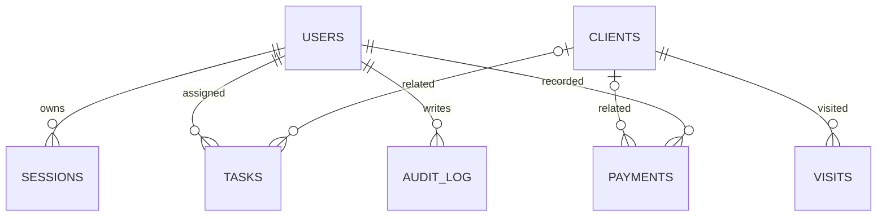

# R0.5 — corporate site topology

Сайт: `src/studio/routes.mjs` → `project.type=site` → `src/site/model.mjs` (строгая схема) → `src/site/db.mjs` (отдельная SQLite) → `src/site/routes.mjs` (SSR HTML + защищённая CMS) → `src/studio/export.mjs` (standalone ZIP). Приложение в Factory открывается по `/workspace/<UUID>/`, standalone — по `/`. Data Studio и CRM API не используются сайтом. `src/site/backup.mjs` обеспечивает офлайн-копии и восстановление. R0.4 CRM экспорт не изменён. См. [WEBSITE_FACTORY.md](WEBSITE_FACTORY.md).

---

# Architecture — OSMANX APP FACTORY v0.1

## Objective

Avoid reimplementing authentication, forms, CRUD, tasks and analytics for each client. The **factory** owns only project configurations; a **CRM runtime** reads a project configuration and implements the actual application. The ZIP exporter copies the runtime and public assets into a self-contained output with a clean initial database.

## Current boundaries

```text
                          OSMANX APP FACTORY
  browser --> server.mjs --> Studio API --> data/studio.sqlite
                    |                |
                    |                +--- Project metadata
                    |                          |
                    |                          +--- exporter --> ZIP
                    |
                    +-- /workspace/:uuid --> CRM API --> data/projects/:uuid.sqlite

  after ZIP export:
  browser --> run.mjs --> CRM API --> data/crm.sqlite
                      \-> public/crm/*
```

The CRM runtime lives in `src/crm`, reusable HTTP/auth/storage tools in `src/common`, and factory control-plane code in `src/studio`.

**Isolation:** each project has a distinct DB filename derived strictly from a validated UUID (not the supplied project name). The exported code makes a new database and initial administrator; no customer information or auth secrets are copied.

**No external package dependencies:** chosen so this artifact genuinely runs in an offline environment. `node:sqlite` is experimental on this Node version; production should migrate to supported SQLite/PostgreSQL client and database migration tooling. This is a design tradeoff, not an assertion that this stack is appropriate for global scale.

## Relational data model

### Studio (`src/studio/schema.sql`)

- `users`: one factory owner (email, scrypt hash, role).
- `sessions`: SHA-256 token hashes, user ID, CSRF token, expiration.
- `projects`: UUID, owner, name, type, industry, JSON modules, JSON settings, timestamps.

### Each CRM (`src/crm/schema.sql`)



- `users`: admin, manager, staff with a salted scrypt hash.
- `clients`: name, contacts, source, comments, archive date.
- `visits`: history of guest visits; repeat count derives from actual stored visits.
- `tasks`: title, description, assignee, optional guest, priority, due date, status.
- `payments`: **manual ledger** in integer minor currency units, method, status, optional guest, optional external reference, idempotency key and request fingerprint.
- `audit_log`: important creation/updates, timestamps and actor. Avoid logging passwords or full guest details.

Timestamps are ISO-8601 UTC text. Monetary values are **integers in kopecks/cents**; amounts from different currencies are never summed together in analytics.

## API contract (selected)

### Factory endpoints

| Method | Path | Description |
| --- | --- | --- |
| GET | `/api/health` | health check |
| GET | `/api/studio/session` | bootstrap status, current session, CSRF |
| POST | `/api/studio/setup` | create first factory owner |
| POST | `/api/studio/login`, `/logout` | session lifecycle |
| GET/POST | `/api/studio/projects` | list/create projects |
| GET/PATCH | `/api/studio/projects/:id` | inspect/update project |
| GET | `/api/studio/projects/:id/export` | independent source ZIP |

### CRM endpoints

The same routes are available at `/workspace/:id/api/...` in the factory or at `/api/...` in a standalone export.

| Method | Path | Required role |
| --- | --- | --- |
| GET | `/api/config`, `/api/health`, `/api/session` | Public |
| POST | `/api/setup`, `/api/login` | Public (bootstrap restrictions apply) |
| POST | `/api/logout` | Authenticated |
| GET/POST | `/api/clients`, `/api/visits`, `/api/tasks` | Authenticated; module enabled |
| PATCH/DELETE | `/api/clients/:id` | Authenticated; module enabled |
| PATCH | `/api/tasks/:id` | Authenticated; module enabled |
| GET/POST | `/api/payments` | Admin or manager; module enabled |
| PATCH | `/api/payments/:id` | Admin or manager; module enabled |
| GET | `/api/analytics` | Admin or manager; module enabled |
| GET | `/api/users` | Authenticated |
| POST | `/api/users` | Admin only |
| GET | `/api/audit` | Admin only |

The endpoints are not GraphQL and do not support arbitrary user-supplied SQL or arbitrary code evaluation.

## Config and generated actions

`blueprints/restaurant-crm.json` defines supported modules, dependencies and defaults. Project settings include the primary action (`new_client`, `new_task`, `new_payment`, `navigate_clients`, `navigate_overview`), currency and validated `#RRGGBB` accent. This is a deliberately **limited no-code action selector**. It is not a general visual workflow editor.

Changes in the factory affect live CRM config on reload and are included in subsequent exports. The currently supported configuration does not regenerate schema columns or permit custom data models.

## Export composition

`src/studio/export.mjs` packages:

- `src/common/**`, `src/crm/**`, `public/crm/**`;
- `templates/standalone/run.mjs` as top-level `run.mjs`;
- `config/project.json`, `package.json`, `.env.example`, `.gitignore` and instructions.

A hand-written pure-JS ZIP builder is in `src/common/zip.mjs`. Its interoperability was verified by extracting in the E2E test and booting the extracted project as a separate child process.

---
## R0.2 architectural extension — Page Builder

- `src/common/pages.mjs`: shared, versioned and strict normalization of page block trees. All action targets are constants; executable scripts and arbitrary data sources are forbidden.
- `src/studio/schema.sql`: `project_pages` linked by foreign key to `projects`, unique `(project_id,slug)`, atomic `revision` conflict control.
- `src/studio/routes.mjs`: owner-only page CRUD (POST/GET/PATCH/DELETE); per-module block validation; default page seeded on project creation.
- `public/studio/editor.js`, `public/studio/app.css`: stateful page designer, no-data preview, block selection, editing, sorting and responsiveness. The Studio does not read CRM guest databases.
- `src/crm/routes.mjs`: authenticated `GET /api/pages` for *published* pages and `GET /api/page-metrics` for role-filtered real SQL aggregates.
- `public/crm/pages.js`: browser interpreter for approved block schema; client/task forms send requests to existing secured CRM endpoints, tables read existing endpoints, metric access restrictions mirror server policy.
- `src/studio/export.mjs`: includes project page configs and all runtime files in the independent source ZIP.

The architecture intentionally keeps **configuration in the Studio database** and **customer records in separate CRM databases**. Studio editor screenshots and previews use only page structure and placeholders; they never read customer contact records. Export packages are snapshots containing code/schema/page definitions only.

---
## R0.3 architectural extension — Data Studio

- `src/common/entities.mjs`: strict cross-runtime schema validator (8 field types, references, roles, additive-only compatibility).
- `src/studio/schema.sql` + `src/studio/routes.mjs`: `project_entities` owned by a project, unique slug and optimistic `revision`; owner-only editor routes.
- `src/crm/entities.mjs`: physical `custom_<slug>` SQLite tables, `custom_entity_schema` snapshots, two-phase table/column creation, add-only migrations, `GET/POST/PATCH/DELETE` validated CRUD, RBAC, CSRF (via session), pagination, reference integrity and soft archive.
- `public/studio/entities.js`: owner-facing 3-panel data designer, responsive layout and no-data preview.
- `public/crm/entities.js`: standard CRUD UI generated directly from schema; `public/crm/app.js` exposes each visible entity as a CRM section.
- `src/common/pages.mjs` and browser page editors now allow form/table sources `custom:<slug>` and approved `create:custom:<slug>` / `navigate:custom:<slug>` button actions.
- Export ZIP contains descriptions and the same schema-aware runtime, not the source CRM tenant database. The independent CRM creates its own physical SQL tables.

**Important:** earlier documentation above describes v0.1/v0.2 at their historical point. This R0.3 extension supersedes claims that the runtime cannot generate additional schema columns.


## R0.4 extension: release control plane and offline operations

```
Factory Studio SQLite
    projects -> pages/entities -> immutable project_releases (sequence, snapshot JSON, SHA-256)
                                | owner-only export
                                v
    ZIP {manifest.json, config/project.json, source, ops.mjs, run.mjs}
                                | manual delivery to installed CRM
                                v
Standalone ops.mjs plan / update
    1. verify manifest, file hashes, project identity, increasing sequence
    2. compare locally installed managed files against installed manifest
    3. migrate a SQLite backup clone (existing safe schema compiler)
    4. require server stop; back up DB + managed files
    5. install code and apply additive migration; manifest last
    6. restore saved snapshot on failure; interruption marker for recovery

Factory scripts/factory_maintenance.mjs
    -> SQLite backup of Studio + all existing project DBs
    -> integrity_check + foreign_key_check + SHA-256 verify
    -> explicit offline restore with a safety snapshot
```

Source layout added: `src/studio/releases.mjs` (immutable Factory releases), `src/common/archive.mjs` (STORE ZIP validation), `src/common/maintenance.mjs` (single-process local locks), `src/common/operations.mjs` (standalone safe plan/update/recovery), `templates/standalone/ops.mjs` (exported command entrypoint), `scripts/factory_maintenance.mjs` (Factory database backup/restore). Manual delivery is intentionally separate from cloud deployment. See [RELEASES_AND_BACKUPS.md](RELEASES_AND_BACKUPS.md).
